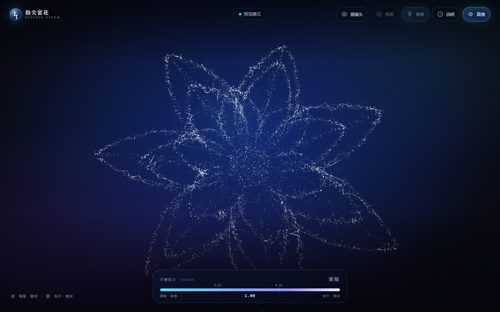

# 指尖雷花 · Electric Storm

用手掌的张开与握合，控制 18000 颗电火花粒子在指尖聚成雷球、再炸开成花。

- **Three.js**：粒子放电束 + 72 条带分叉的动态电弧 + 静态叶形骨架，单个 `THREE.Points` 由顶点着色器在“雷球 / 绽放”两套坐标间插值。
- **虚拟照亮与爆发过冲**：强闪时以雷球中心照亮粒子内侧；张开时粒子沿初速度先炸出再回弹，收拢时轻微挤压。
- **分形指尖雷电**：MediaPipe 的 21 个关键点同时驱动一层 2D 电弧；`js/lightning.js` 用中点位移递归生成主弧、子分支与折返，五指指尖/指骨/掌缘独立放电，张开时把长弧甩向花心。
- **三连击强闪与采样音效**：`js/flash.js` 用三个高斯脉冲生成亮-暗-亮节奏；`js/audio.js` 播放 `assets/audio/electric-arc.mp3`，并按张开度调整音高、低通截止与响度。
- **MediaPipe Hands**：浏览器本地识别 21 个手部关键点，不上传任何画面。
- **原生 HTML / CSS / JavaScript**，ES Module 直接加载本地 vendor 文件，无需构建。



---

## 快速开始

项目必须通过 **HTTP** 打开（ES Module 和摄像头权限都不支持 `file://`）。

**以后最省事的方式：双击项目根目录的 `start-flower.bat`。** 它会启动本地服务器并自动打开浏览器；服务器窗口不要关，关掉即停止。

也可以在 PowerShell 里手动启动：

```powershell
# 在 D:\flower 下任选一种
node serve.mjs 5173        # 项目自带，零依赖，已配置 wasm / tflite 的 MIME
# 或
python -m http.server 5173
# 或
npx serve .
```

然后访问 <http://localhost:5173>（`serve.mjs` 默认监听 127.0.0.1:5173）。

推荐 Chrome / Edge 最新版。首次点击「开启摄像头」时，MediaPipe 会从本地 `vendor/hands/` 加载约 24MB 的 wasm 与模型文件；如果本地文件缺失，会自动回退到 jsDelivr CDN。手机通过局域网 IP 访问时，浏览器要求 **HTTPS** 才能使用摄像头，请用 `localhost` 或配置 HTTPS 隧道。

> 摄像头画面与关键点全部在浏览器本地处理，没有任何上传请求。关闭摄像头后视频流会立即释放。

---

## 手势与映射

| 手势 | tension | 雷电 |
| --- | --- | --- |
| 握拳 | `< 0.32` | 电光收拢成一团过曝雷球，掌缘电弧绕球爬行 |
| 半张 | `0.32 – 0.66` | 雷球电离、拉伸，电弧从球面爬向指尖 |
| 五指张开 | `> 0.66` | 掌心向外甩出长电弧，五指指尖持续放电 |

### 1. 手掌张开度 tension

以手腕到四个掌指关节（MCP）的平均距离作为手掌尺度：

```text
palm  = mean(|wrist − mcp_i|)              i = 5, 9, 13, 17

ext_i = clamp((|tip_i − wrist| − |mcp_i − wrist|) / palm / 0.95, 0, 1)
thumb = clamp((|tip4 − mcp5| / palm − 0.62) / 0.85, 0, 1)

tension = 0.27·ext_index  + 0.24·ext_middle
        + 0.19·ext_ring   + 0.15·ext_pinky
        + 0.15·thumb
```

握拳时指尖缩回掌心，`|tip − wrist|` 接近 `|mcp − wrist|`，`ext ≈ 0`；张开时差值约为一个手掌，`ext ≈ 1`。距离在按视频宽高比校正后的坐标中计算，避免 16:9 / 4:3 拉伸造成误差。结果再做指数平滑（张开略快、收拢略慢），见 `js/gesture.js`。

### 2. 张力 → 绽放

```js
const targetSpread = smoothstep(0.32, 0.66, tension);       // 阈值映射
// 张开是爆发，收回是凝聚：两个方向用不同的 lambda
const lambda = targetSpread > state.spread
  ? CONFIG.smoothing.spreadOut   // 0.62，约 100ms 完成
  : CONFIG.smoothing.spreadIn;   // 0.12，慢慢收拢
state.spread = damp(state.spread, targetSpread, lambda, dt);
```

`damp()` 对 `dt` 做了归一化，因此 60Hz / 120Hz / 30Hz 屏幕上的手感一致。摄像头模式下，检测不到手时张力目标为 `0.24`，不会因为短暂丢手而突然闭合；指尖电弧层会在约 0.3s 内淡出。

### 3. 雷电几何

- 3 层共 20 片花瓣，每片用闭合的叶形轮廓采样：半宽 `w(t)=width·0.5·sin(π·t^0.82)^0.78`，62% 粒子贴左右叶缘，10% 走主脉，28% 稀疏填充内部。
- 花苞不是花瓣收拢，而是一颗电离球：82% 粒子填充球体，18% 沿 56 根放射细丝拉出尖刺，球心再叠加高密度电核。
- 每颗粒子同时存有 `aOpen`（绽放）与 `aBud`（雷球）坐标；顶点着色器按 `uSpread` 插值，并叠加：
  - 按 `aDelay` 错峰引爆（外层花瓣先炸，花心最后）；
  - 高频电颤、游离火花与 `uSurge` 爆闪；
  - 以指尖 NDC 坐标为中心的斥力场；
  - 闪烁与径向柔光，`ACESFilmic` tone mapping 后输出。
- 额外的发光 `LineSegments` 骨架勾出每片花瓣的左右叶缘、主脉与侧脉，并用时间噪声逐段闪烁；72 条动态电弧每帧重建，带 2 条分叉，大部分沿叶缘爬行，少量从花心劈向瓣尖。
- 花苞外层还有 840 颗高速旋转的 corona 光点、两个随 spread 变化触发的爆闪电环，以及从球面拉出的长电枝。
- 独立的前景 Canvas 负责“指尖雷电”：`lightning.js` 用**中点位移**递归 5 次生成主弧，再在主干上劈出 2 层子分支；每段位移幅度按长度缩放，并有 22% 概率插入沿切线回退的折返点。电弧按 **8–15Hz 放电节拍**重生成，帧间在 `prev / cur` 两套点之间插值，避免每帧噪声闪烁。
- 电弧用三层叠加绘制：近白内芯 `#f2ffff`、青蓝中层 `#7fe6ff`、紫蓝外层 `#3a6bff`，外层用低通噪声闪动；Canvas 用 `destination-out` 保留约 0.15s 余辉，再叠加半分辨率 bloom。每隔 0.4–1.5s 触发一次强闪，并让相机产生与放电强度相关的轻微 handheld shake。
- 五指指尖、DIP 指骨、指节凸起与掌缘分别有独立的电弧；手指快速移动时电弧被“风”拖在后面，指间距离足够近时会击穿出细小火花。

---

## 操作

| 操作 | 说明 |
| --- | --- |
| 开启摄像头 | 请求权限并启动 MediaPipe，成功后进入手部模式 |
| 先看演示 | 不开启摄像头，花朵按呼吸节奏自动开合 |
| 摄像头按钮 / `C` | 开启或关闭摄像头 |
| 画面按钮 / `B` | 显示 / 隐藏摄像头背景 |
| 骨架按钮 / `H` | 显示 / 隐藏 21 关键点连线 |
| 说明按钮 / `I` | 打开算法说明面板 |
| 音效按钮 / `M` | 开启 / 静音电流音效 |
| `Esc` | 关闭说明面板 |

摄像头被拒绝、未找到或被占用时，会显示中文提示并自动留在演示模式。也可以直接点击「先看演示」。

### URL 参数

| 参数 | 示例 | 作用 |
| --- | --- | --- |
| `particles` | `?particles=20000` | 粒子数量，夹紧到 5000–20000 |
| `spread` | `?spread=0.8` | 锁定绽放程度，跳过手势（截图 / 调试） |
| `demo` | `?demo=1` | 直接进入演示模式，不显示开场卡片 |
| `cam` | `?cam=1` | 载入后自动申请摄像头 |
| `debug` | `?debug=1` | 显示 FPS / draw call / tension 等调试信息 |
| `hand` | `?hand=1` | 无摄像头合成手部，用于预览指尖放电 |
| `tension` | `?hand=1&tension=0.2` | 合成手部的目标张力，便于检查握拳 / 半开状态 |
| `skeleton` | `?skeleton=0` | 隐藏 21 点骨架，仅保留指尖放电 |

### 控制台 API

```js
BLOOM.setParticleCount(20000);  // 重建粒子（5000–20000）
BLOOM.setSpread(0.8);           // 锁定绽放程度
BLOOM.autoSpread();             // 恢复手势 / 自动演示
BLOOM.startCamera();            // 等价于点击「开启摄像头」
BLOOM.stopCamera();
BLOOM.state;                    // { mode, tension, spread, handPresent, fps, ... }
```

---

## 目录结构

```text
flower/
├─ index.html              页面结构 / HUD / 算法说明
├─ styles.css              深色玻璃 HUD、响应式布局
├─ js/
│  ├─ config.js            所有可调参数 + clamp / smoothstep / damp
│  ├─ main.js              渲染循环、状态机、UI、摄像头启停
│  ├─ flower.js            雷电花几何 + GLSL、动态电弧、骨架、光晕、星尘
│  ├─ lightning.js         中点位移分形、分支、节拍、强闪、拖尾数据
│  ├─ flash.js             三连击高斯闪光控制器
│  ├─ audio.js             电流采样播放 + 手势映射（音高 / 滤波 / 音量）
│  ├─ fingerlightning.js   手指 / 掌心 2D 电弧绘制、余辉、bloom、手掌遮挡
│  ├─ gesture.js           MediaPipe 加载、摄像头、21 点、tension 公式
│  └─ overlay.js           2D 手部骨架叠加层（与 CSS cover 对齐）
├─ start-flower.bat         双击启动服务器并打开浏览器
├─ serve.mjs               零依赖本地静态服务器（node serve.mjs 5173）
├─ vendor/
│  ├─ three.module.js      Three.js r160
│  └─ hands/               MediaPipe Hands 0.4.1675469240（本地优先）
├─ assets/audio/
│  └─ electric-arc.mp3      手势映射的电流采样
├─ tools/shot.mjs          CDP 截图 / 控制台检查（开发辅助，可删）
└─ docs/preview.png        预览图
```

### 常用配置（`js/config.js`）

| 字段 | 默认 | 说明 |
| --- | --- | --- |
| `particles` | `18000` | 默认粒子数（5000–20000） |
| `pollen` | `760` | 花瓣外飘浮的电离火花 |
| `stars` | `900` | 背景星尘 |
| `thresholds.closed` | `0.32` | 低于此值视为花苞 |
| `thresholds.open` | `0.66` | 高于此值视为完全绽放 |
| `smoothing.spreadOut` | `0.62` | 张开爆发阻尼（约 100ms 跟上） |
| `smoothing.spreadIn` | `0.12` | 收回凝聚阻尼 |
| `lightning.beatMin/Max` | `8 / 15` | 电弧每秒重生成次数 |
| `lightning.branchDepth` | `2` | 分形子分支层数 |
| `lightning.trailSeconds` | `0.16` | Canvas 余辉时长 |
| `lightning.bloom` | `true` | 半分辨率 bloom 开关 |
| `lightning.flashMin/Max` | `0.4 / 1.5` | 随机强闪间隔（秒） |
| `lightning.flashOnsets/Amps` | `[0,.06,.13] / [1,.62,.38]` | 三连击高斯脉冲时间与幅度 |
| `lightning.flashSigma` | `0.028` | 单次脉冲宽度（秒） |
| `lightning.shakeAmp` | `0.004` | 强闪相机震动幅度 |
| `audio.sampleUrl` | `./assets/audio/electric-arc.mp3` | 用户提供的电流采样 |
| `audio.masterVolume` | `0.7` | 音效总音量 |
| `audio.crackGain` | `0.55` | 主放电增益 |
| `audio.strokeDuration` | `0.42` | 主放电采样时长（秒） |
| `audio.strokeRateClosed/Open` | `0.78 / 1.12` | 握拳 / 张开的播放速率 |
| `audio.strokeCutClosed/Open` | `900 / 4200` | 握拳 / 张开的低通截止（Hz） |
| `audio.humGainClosed/Open` | `0.10 / 0.05` | 握拳 / 张开时环境嗡鸣增益 |
| `audio.humCutClosed/Open` | `180 / 900` | 握拳 / 张开时嗡鸣低通截止（Hz） |
| `audio.humRateClosed/Open` | `0.52 / 0.68` | 握拳 / 张开时嗡鸣播放速率 |
| `camera.detectFps` | `26` | 每秒送入模型的帧数（渲染仍为 60fps） |
| `camera.complexity` | `1` | 0 = lite 模型，1 = full 模型 |
| `render.maxDpr` | `2` | 最大设备像素比 |

---

## 性能与兼容性

- 花体只有 1 个 `Points` draw call；另有动态电弧的 LineSegments + 发光点、骨架、火花、光晕、爆闪环、corona 与星尘，总 draw call 约 12 个。
- 手部识别限制在 26fps，渲染不等待模型；`hands.send()` 用 busy 锁避免堆积。
- 设备像素比上限 2；若开场 9 秒后持续低于 38fps，会自动把渲染分辨率降到 1.25x。指尖 Canvas 以 0.62× 内部分辨率绘制再放大，既保留辉光又给 1080p 留出余量。音效在用户手势后创建 AudioContext 并解码一次采样；每次强闪复用同一采样，按张开度设置播放速率与低通截止，节点播完自动断开，同时节点上限 14。
- 摄像头画面使用 `object-fit: cover` + `scaleX(-1)`；骨架按同样的裁切公式绘制，因此横竖屏都能对齐。
- 桌面与移动端均有响应式布局，支持 `env(safe-area-inset-*)`。
- 需要 WebGL2 / WebGL1 与 `getUserMedia`。不支持时会显示提示。

### 常见问题

**页面空白 / 模块加载失败**
请用 `http://localhost` 打开，不要双击 `index.html`。`file://` 下 ES Module 会被 CORS 拦截。

**点击开启摄像头没有反应**
检查地址栏权限；Windows 设置 → 隐私和安全性 → 摄像头，确认浏览器被允许访问。若在远程桌面或虚拟机中，摄像头可能不可用。

**识别很慢 / 一直「加载识别模型」**
确认 `vendor/hands/` 下 10 个文件完整（约 24MB）。本地文件缺失时会回退 CDN，首次仍需下载。打开 `?debug=1` 查看 phase。

**画面是黑屏**
确认摄像头未被会议软件占用；或尝试 `?debug=1` 查看 WebGL / 视频尺寸。更新显卡驱动或开启浏览器硬件加速。

**移动端手部总在画面边缘**
竖屏下 `cover` 会裁掉左右两侧。把手放在画面中央，或横屏使用。

---

## 第三方资源

- [Three.js](https://threejs.org/) r160，MIT License，本地文件 `vendor/three.module.js`。
- [MediaPipe Hands](https://developers.google.com/mediapipe) `@mediapipe/hands@0.4.1675469240`，Apache-2.0，本地文件位于 `vendor/hands/`，来源 jsDelivr。
- `assets/audio/electric-arc.mp3` 由项目使用者提供，仅本地播放；对外发布前请确认该采样的授权。

摄像头视频、关键点与所有计算均留在本地浏览器内。
